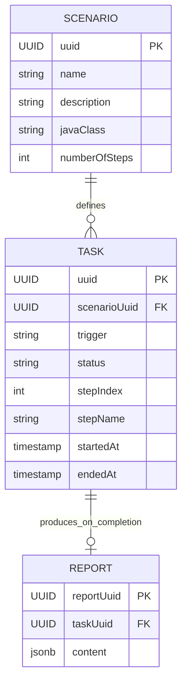
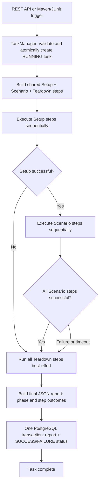
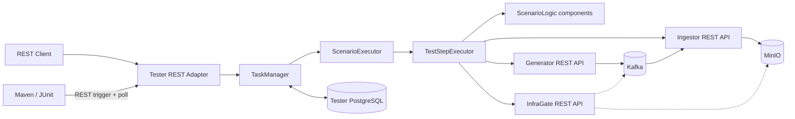

# CommerceETLAV Tester

[← CommerceETLAV Manager](https://github.com/orbartal/commerce-etlav-manager) | [Generator](https://github.com/orbartal/commerce-etlav-generator) | [Ingestor](https://github.com/orbartal/commerce-etlav-ingestor) | [InfraGate](https://github.com/orbartal/commerce-etlav-infra-gateway)

Tester orchestrates and validates the CommerceETLAV event flow, from scenario publication through Kafka ingestion and MinIO persistence. It creates persistent, observable tasks that can be triggered through REST or Maven/JUnit. This document describes the **MVP implementation contract**; newer approved decisions take precedence over conflicting older repository documentation.

## Table of Contents

1. [Context and Goals](#1-context-and-goals)
2. [Test Concepts and Model](#2-test-concepts-and-model)
3. [General Test Flow](#3-general-test-flow)
4. [Scenario and Event Model](#4-scenario-and-event-model)
5. [Tester Architecture](#5-tester-architecture)
6. [Technology Stack](#6-technology-stack)
7. [MVP Scope and Limitations](#7-mvp-scope-and-limitations)
8. [Task Execution](#8-task-execution)
9. [Validation Mechanism](#9-validation-mechanism)
10. [Tester API](#10-tester-api)
11. [Reports and Persistence](#11-reports-and-persistence)
12. [Errors and Tracing](#12-errors-and-tracing)
13. [Tester Configuration](#13-tester-configuration)
14. [Development and Deployment](#14-development-and-deployment)
15. [Future Extensions and References](#15-future-extensions-and-references)

---

## 1. Context and Goals

### 1.1 CommerceETLAV Context

The MVP event flow is **Generator → Kafka → Ingestor → MinIO**. Generator publishes original scenario events; Ingestor consumes and persists them. Tester runs with these services in the [Manager Docker Compose environment](https://github.com/orbartal/commerce-etlav-manager). InfraGate is a **test-only** REST gateway to Kafka and MinIO; Tester does not access those infrastructure systems directly.

### 1.2 Tester Responsibilities

- Register and validate Tester scenarios.
- Create, execute, and track test tasks.
- Prepare a clean environment using Ingestor and InfraGate APIs.
- Trigger Generator publication and validate the resulting data.
- Record step progress, failures, and final JSON reports in PostgreSQL.
- Support REST and Maven/JUnit entry points through the same executor.
- Expose task history, reports, and operational readiness.

### 1.3 Goals and Non-Responsibilities

MVP favors a working, reproducible end-to-end demonstration over exhaustive infrastructure, scale, or recovery features. Tester does **not** implement Kafka consumption, MinIO storage, Generator business logic, or infrastructure cleanup itself. It coordinates their existing APIs.

## 2. Test Concepts and Model

### 2.1 Test and Scenario

A **test** is Java code expressing the scenario-specific verification logic. A **Tester Scenario** is a registered test definition with UUID, name, description, Java implementation, and step count. A Tester Scenario is distinct from a Generator Scenario: the MVP maps one Tester Scenario to one Generator Scenario UUID, but future Tester scenarios may combine multiple Generator scenarios or vary service configuration.

Each scenario has three representations: **Spring Boot configuration**, a **PostgreSQL Scenario row**, and a **Spring `@Component` implementing `ScenarioLogic`**. All must agree at startup.

### 2.2 Task and Trigger

A **Task** is one execution of a Tester Scenario. Repeated executions create distinct task UUIDs and reports. `trigger` is a Task property (`REST_API` or `CMD`), **not** a database entity. REST and Maven/JUnit use the same running Tester service and executor. MVP permits **at most one RUNNING task** across both entry points.

### 2.3 Test Steps

A scenario implementation supplies an ordered list of `TestStep` definitions. Each has `scenarioId`, execution `taskId`, `stepIndex` (starting at **1**), `name`, and an action returning a `CompletionStage`. The `stepIndex` replaces an explicit `nextStep` reference. Steps are defined in Java; they are **not separate SQL entities**. The Task row tracks its current step index and name. Shared setup and teardown steps are composed with scenario-specific steps when constructing the task execution plan.

### 2.4 Task Status

| Status | `isComplete` | `isSuccess` | Meaning |
|---|---|---|---|
| `RUNNING` | `false` | `false` | Execution in progress |
| `SUCCESS` | `true` | `true` | All required phases succeeded |
| `FAILURE` | `true` | `false` | A phase failed, timed out, or was interrupted |

A Task progresses from `RUNNING` to one terminal state. **Task status** is separate from Tester **service readiness** (`STARTUP`, `READY`, `SHUTDOWN`, `INTERNAL_ERROR`).

### 2.5 Test Report

A report is written **only when the Task finishes**. Every completed Task has one report, whether successful or failed; a running Task has none. The report contains final status, timestamps, Setup/Scenario/Teardown outcomes, step-level results, and errors. Logs and the Task API provide live progress; MVP has no partial reports.

### 2.6 Entity Relationships



## 3. General Test Flow

### 3.1 Task Creation

A trigger identifies a Tester Scenario UUID. TaskManager validates the scenario, checks Tester readiness, and atomically ensures no other task is RUNNING before persisting a new Task. REST returns **202 Accepted** and the task UUID without waiting for execution. Maven/JUnit invokes the same REST API and waits for terminal status.

### 3.2 Setup Phase

Shared setup steps check Ingestor, disable its consumer if running, require manual recovery for `FAILED`, reset Ingestor's in-memory data, clean Kafka and MinIO through InfraGate, verify cleanup, and enable consumption. A setup failure skips the remaining setup and scenario steps, then enters teardown.

### 3.3 Scenario Phase

The scenario-specific ordered steps run one after another. Each step completes its `CompletionStage` before the next begins. A failure or timeout skips the remaining scenario steps.

### 3.4 Teardown Phase

Teardown always runs, including after setup or scenario failure. It attempts to disable Ingestor consumption and preserves data for investigation. **Every teardown step is best-effort**: on failure, log the error, do not retry, and continue remaining teardown steps. Any teardown failure makes the final Task `FAILURE`.

### 3.5 Report and Completion

Build the final JSON report after teardown. Persist the Report and terminal Task status **atomically in one PostgreSQL transaction**. If persistence fails, log the failure, enter `INTERNAL_ERROR`, stop accepting tasks, and require manual investigation.

### 3.6 Task Execution Diagram



## 4. Scenario and Event Model

### 4.1 Tester vs Generator Scenarios

Tester owns test definitions, execution logic, and results. Generator owns event-generation scenario definitions and original event data. A Tester scenario references its Generator scenario UUID through Spring Boot configuration, not by sharing Generator's scenario table.

### 4.2 Scenario Configuration

Each configured Tester scenario identifies its UUID, associated Generator scenario UUID, and implementation registration. The SQL Scenario table stores the descriptive and structural metadata. Java scenario code defines its steps and behavior. MVP uses a one-to-one mapping to Generator; this is not a permanent architectural restriction.

### 4.3 Scenario Registration and Validation

A Python SQL initialization script populates Tester Scenario records. On startup, Tester checks **every** scenario for matching SQL row, Spring Boot configuration, and Spring-managed Java implementation, including the expected step count. Missing or inconsistent definitions **fail application startup** with a diagnostic message.

### 4.4 First MVP Scenario

The initial scenario-specific steps are:

1. Trigger Generator to publish events.
2. Wait asynchronously for **five minutes**.
3. Validate persisted data using InfraGate.
4. Validate data recorded by Ingestor.

Shared Setup and Teardown steps are automatically added around these four steps. The fixed wait is deliberately simple; future versions can replace it with completion polling and an upper time limit.

### 4.5 Expected Events and Results

Generator supplies expected scenario event identifiers and original payloads. Tester compares these with Ingestor's successfully stored event IDs and MinIO objects obtained **through InfraGate**. Dataset and event UUIDs are the matching keys. The original event payload in MinIO must equal Generator's original event; ingestion metadata is excluded from payload equality.

## 5. Tester Architecture

### 5.1 Architecture Diagram



### 5.2 Internal Components

| Component | Responsibility |
|---|---|
| REST Adapter | Validate requests, create tasks, expose queries and readiness |
| Maven/JUnit Adapter | Trigger REST execution and await completion |
| TaskManager | Task lifecycle, concurrency, persistence, recovery, completion |
| ScenarioExecutor | Resolve scenario implementation and build ordered step plan |
| TestStepExecutor | Execute steps, track progress, handle completion, timeout and failure |
| ScenarioLogic | Scenario-specific step definitions and actions |
| Persistence layer | Scenario, Task, Report repositories and transactions |
| Async HTTP clients | Nonblocking REST calls to other microservices |

### 5.3 ScenarioLogic Interface

Each scenario is a Spring `@Component` implementing a common `ScenarioLogic` interface. The interface exposes scenario identity/properties and an ordered list of scenario-specific `TestStep` definitions. No abstract test superclass or inheritance-driven execution framework is required.

### 5.4 TaskManager and ScenarioExecutor

TaskManager owns task creation, readiness/concurrency checks, completion, and persistence. ScenarioExecutor resolves the matching `ScenarioLogic` and assembles **shared Setup + scenario steps + shared Teardown** in one place. Scenario logic must not directly manipulate task lifecycle state.

### 5.5 TestStepExecutor

TestStepExecutor starts a step, persists its index/name before running its action, and observes its returned `CompletionStage`. On success it advances to the next step; on failure or timeout it applies phase-specific failure rules. Step actions signal completion rather than invoking subsequent steps themselves.

### 5.6 External Service Integration

Tester uses REST for Generator, Ingestor, and InfraGate. InfraGate alone communicates with Kafka and MinIO for test inspection and cleanup. Exact InfraGate read-only API paths are deferred to its own README; required capabilities are specified in Section 9.

## 6. Technology Stack

### 6.1 Selected Technologies

| Area | Technology |
|---|---|
| Language | Java 27 |
| Application | Spring Boot 4, Spring MVC |
| Build and CLI test trigger | Maven 3, JUnit |
| Async composition | `CompletionStage` / `CompletableFuture` |
| Scheduling | One shared `ScheduledExecutorService` |
| External calls | Asynchronous HTTP client |
| Persistence | Spring Data JPA / PostgreSQL (`jsonb` for report content) |
| Health | Spring Boot Actuator |
| Packaging | Docker, Manager Docker Compose |
| Future conditional polling | Awaitility or equivalent, when introduced |

### 6.2 Technology Principles

Use composition rather than abstract test-class inheritance. Keep adapters thin and orchestration shared. Do not block the scheduling thread for waits or HTTP responses. Prefer one simple implementation of each concern over frameworks for retries, distributed coordination, or parallel test execution.

## 7. MVP Scope and Limitations

### 7.1 MVP Capabilities

- REST and Maven/JUnit triggers, both using the running Tester service.
- One active task at a time, with repeatable scenario execution.
- Asynchronous, sequential steps and a global step timeout.
- Shared setup/teardown and phase-specific failure behavior.
- Persistent Scenario, Task, and final Report records.
- Paginated scenario, task, and report queries.
- Startup scenario validation and interrupted-task recovery.
- Separate Tester PostgreSQL container and operational readiness API.

### 7.2 MVP Constraints

- Only one Tester task can be RUNNING, regardless of trigger.
- One Generator scenario per Tester scenario.
- Fixed five-minute asynchronous wait in the first scenario.
- One global timeout for **every** step type and phase.
- No automatic retries or failure recovery during task execution.
- No partial reports or per-step SQL entity.
- No user-selectable filtering, sorting, or searching.

### 7.3 Deferred Capabilities

Parallel tasks, per-step timeouts, persistent task resumption, retry policies, dynamic step branching, multiple Generator scenarios per Tester scenario, progress streaming, report downloads, and richer event-driven completion are future work.

## 8. Task Execution

### 8.1 Shared Step List

Build the ordered execution plan centrally: Setup steps, scenario-specific steps, Teardown steps. `stepIndex` is **1-based** within the execution plan; the Task API also reports the total step count and current step name. Scenario metadata's `numberOfSteps` refers to the scenario-specific steps; the task's execution-plan maximum includes shared steps.

### 8.2 Asynchronous Step Execution

Each step starts an action and returns immediately with a `CompletionStage` representing its eventual result. The next step starts only after that stage succeeds. A step can call an asynchronous REST endpoint or schedule a nonblocking delay. A `CompletionStage` does **not** make blocking code nonblocking: use asynchronous clients and scheduled waits.

### 8.3 CompletionStage Contract

A successful completion advances the plan. Exceptional completion or timeout records failure. Only TestStepExecutor advances steps; step actions do not call the next step directly. This design permits future parallel tasks without changing scenario logic.

### 8.4 Scheduling and Timeouts

One shared `ScheduledExecutorService` schedules delays and timeout enforcement. A **single Spring Boot timeout value** applies to every Setup, Scenario, and Teardown step. It must exceed the expected five-minute wait plus scheduling margin. No per-step override or retry exists in MVP. On timeout, mark the step failed and apply its phase's failure rules.

### 8.5 Step Progress Tracking

Before executing each step, persist its `stepIndex` and `stepName` on the Task. Log step start, completion, duration, and error. A running Task's progress is visible through the Task API and logs; no partial report is persisted.

### 8.6 Failure Handling and Teardown

| Failure phase | Behavior |
|---|---|
| Setup | Stop remaining Setup; skip Scenario; execute Teardown |
| Scenario | Stop remaining Scenario; execute Teardown |
| Teardown | Record error; skip failed step; continue remaining Teardown |
| Any phase timeout | Treat as step failure; no retry |
| Any phase failure | Final Task status is `FAILURE` |

Teardown attempts to disable Ingestor consumption **once**. If Ingestor rejects disable because it is busy or unavailable, log the error and continue. Do not reset or erase failure evidence.

### 8.7 Concurrency Control

The no-running-task check and creation of a new `RUNNING` Task must be **atomic**, preventing concurrent REST requests from both starting tasks. This rule applies equally to CMD-triggered calls. An attempted second task returns a dedicated HTTP `409 Conflict` error. `READY` describes service readiness, not the absence of an active task.

### 8.8 Startup Recovery

Before accepting task requests, Tester finds all persisted `RUNNING` tasks, marks each `FAILURE`, and creates an interruption report. Each recovered Task's report and final status are committed atomically. No original steps or teardown are resumed after restart. If recovery cannot complete, Tester is not ready to accept new tasks.

## 9. Validation Mechanism

### 9.1 Validation Responsibilities

Tester orchestrates and evaluates conditions; Generator supplies expected original events, Ingestor exposes successful event identifiers/status, and InfraGate reads persisted MinIO data and performs infrastructure cleanup. Tester does not connect to Kafka or MinIO directly.

### 9.2 Generator Validation

For a chosen Generator scenario, determine the expected event count, UUID set, and original payloads. Trigger publication through Generator's REST API. MVP publication is synchronous; the fixed wait remains a separate step for simple end-to-end timing.

### 9.3 Ingestor Validation

Read Ingestor's operational status and successful event IDs. Verify expected unique-event count and IDs. A `FAILED` Ingestor status is a test failure. Do not assume `consumedEventCount` equals unique events when duplicate Kafka deliveries occur.

### 9.4 MinIO Validation via InfraGate

InfraGate must support Kafka/MinIO cleanup verification, persisted object count, event identifier listing, and retrieval of complete stored envelopes. Tester validates expected objects exist and that **no unexpected objects** are present for the test dataset. The exact read-only endpoint names will be specified in InfraGate's README.

### 9.5 Event Identifier and Payload Comparison

Compare UUID sets across **Generator, Ingestor, and MinIO**; compare full original event payloads **between Generator and MinIO**. MinIO's envelope metadata (`ingestedAt`, `storedAt`) is not part of original-payload equality. A matching count alone is insufficient if identifiers differ.

### 9.6 MVP Fixed Wait and Future Polling

The first scenario waits asynchronously for five minutes, then validates. Later, replace the fixed delay with condition-based polling (including early success and a maximum timeout). Do not implement that extra complexity in the initial scenario.

## 10. Tester API

All API paths intentionally include the **`/tester`** prefix, even when the service hostname is also `tester`. Collection endpoints support `index` (zero-based, default `0`) and `size` (default `10`), with a fixed server-defined order and no filter/search/sort options in MVP.

### 10.1 API Conventions and Pagination

| Method | Full path | Result |
|---|---|---|
| GET | `/tester/api/v1/scenarios` | Paginated UUID/name pairs |
| GET | `/tester/api/v1/scenarios/{scenarioUuid}` | Scenario details and description |
| POST | `/tester/api/v1/scenarios/{scenarioUuid}/run` | Create Task, return UUID |
| GET | `/tester/api/v1/tasks/all/run` | Paginated RUNNING tasks |
| GET | `/tester/api/v1/tasks/all/history` | Paginated task history |
| GET | `/tester/api/v1/tasks/one/{taskUuid}` | One Task with current step |
| GET | `/tester/api/v1/report` | Paginated report references |
| GET | `/tester/api/v1/report/task/{taskUuid}` | Final report JSON |
| GET | `/tester/api/v1/status` | Tester operational readiness |

Use a consistent paged envelope, for example:

```json
{
  "items": [],
  "index": 0,
  "size": 10,
  "totalItems": 0,
  "totalPages": 0
}
```

### 10.2 Scenario APIs

`GET /tester/api/v1/scenarios` returns `{ "scenarioUuid": "...", "name": "..." }` items. `GET /tester/api/v1/scenarios/{scenarioUuid}` additionally returns description, Java class identity, and configured number of scenario steps. Scenario definitions are read-only through the MVP API.

### 10.3 Task Execution API

`POST /tester/api/v1/scenarios/{scenarioUuid}/run` takes **no request body**. It atomically creates a `RUNNING` Task and returns HTTP **202 Accepted**:

```json
{ "taskUuid": "a7f00000-0000-4000-8000-000000000001" }
```

A missing scenario returns `404`; another running task or unavailable Tester returns an appropriate error (typically `409` for task concurrency, `503` for service unavailability). The stored trigger is `REST_API` for ordinary REST callers and `CMD` when the Maven/JUnit adapter identifies itself through the agreed internal invocation convention; no additional public request-body field is required.

### 10.4 Task Query APIs

`GET /tester/api/v1/tasks/all/run` returns RUNNING tasks (at most one in MVP). `GET /tester/api/v1/tasks/all/history` returns all tasks, including running and completed, in fixed **`startedAt DESC`** order. `GET /tester/api/v1/tasks/one/{taskUuid}` returns:

```json
{
  "taskUuid": "a7f00000-0000-4000-8000-000000000001",
  "scenarioUuid": "550e8400-e29b-41d4-a716-446655440000",
  "scenarioName": "Basic Purchase",
  "trigger": "REST_API",
  "status": "RUNNING",
  "isComplete": false,
  "isSuccess": false,
  "startedAt": "2026-11-01T15:00:00Z",
  "endedAt": null,
  "reportUuid": null,
  "step": {
    "maxSteps": 10,
    "index": 3,
    "name": "Enable Ingestor Consumer"
  }
}
```

`maxSteps` includes shared Setup, scenario, and Teardown steps. A completed Task includes its `reportUuid` and terminal status.

### 10.5 Report APIs

`GET /tester/api/v1/report` returns paginated `{ "taskUuid": "...", "reportUuid": "..." }` references. `GET /tester/api/v1/report/task/{taskUuid}` returns the final report UUID, task UUID, and full JSON content. **Running tasks have no report**; requesting one returns `404 Not Found`.

### 10.6 Tester Status API

`GET /tester/api/v1/status` returns:

```json
{
  "status": "READY",
  "description": "Initialization completed; Tester can accept task requests."
}
```

| Value | Meaning |
|---|---|
| `STARTUP` | Initializing, validating scenarios, and recovering interrupted tasks |
| `READY` | Operationally ready; may already have one running task |
| `SHUTDOWN` | Stopping and rejecting new task creation |
| `INTERNAL_ERROR` | Unsafe to accept tasks, e.g. DB or final-report persistence failure |

The status endpoint should remain available during initialization or errors **when the HTTP server is running**. Task requests are rejected until startup validation/recovery completes. Spring Actuator health is separate from this operational status.

### 10.7 Error Responses

Use dedicated application error types and a consistent JSON error envelope, including error type, message, and request/exception identifiers where available. Invalid scenario, task, report, state, configuration, and persistence failures must be distinguishable. Do not expose internal stack traces to API callers.

## 11. Reports and Persistence

### 11.1 PostgreSQL Ownership

Tester owns a **dedicated PostgreSQL Docker container** (not a shared container with Generator), for independent ownership, monitoring, tracing, and troubleshooting. Tester is the only owner of its Scenario, Task, and Report data.

### 11.2 Database Entities

| Entity | MVP fields |
|---|---|
| `Scenario` | UUID, name, description, Java test class, number of steps |
| `Task` | UUID, scenario UUID, trigger, current step index/name, status, start/end timestamps |
| `Report` | report UUID, task UUID (unique), JSON content |

`isComplete` and `isSuccess` derive from the Task status enum. Step details live in the final report JSON, not a separate SQL Step table.

### 11.3 Scenario Initialization

A Python SQL initialization script writes the initial Scenario records. Spring Boot configuration supplies scenario-specific configuration (including Generator scenario UUID). At startup, verify all SQL/config/Java registrations are complete and consistent; fail startup on any mismatch.

### 11.4 Task Persistence

Create the Task before starting steps. Persist current step index/name **before** each action. Maintain start and end timestamps. The task and logs show progress while the report does not yet exist.

### 11.5 Report JSON Structure

The final JSON contains task/scenario IDs, outcome, start/end timestamps, and separate Setup, Scenario, and Teardown sections. Each section contains status, timestamps, step results, and errors. Phase statuses are `SUCCESS`, `FAILURE`, or `SKIPPED` where applicable; teardown is attempted even after earlier failures.

Example abbreviated content:

```json
{
  "taskUuid": "a7f00000-0000-4000-8000-000000000001",
  "scenarioUuid": "550e8400-e29b-41d4-a716-446655440000",
  "result": "FAILURE",
  "startedAt": "2026-11-01T15:00:00Z",
  "endedAt": "2026-11-01T15:05:03Z",
  "setup": { "status": "SUCCESS", "steps": [] },
  "scenario": { "status": "FAILURE", "steps": [], "error": "Validation failed" },
  "teardown": { "status": "SUCCESS", "steps": [] }
}
```

Each actual step record should include its index, name, start/end timestamps, result, and error details when applicable.

### 11.6 Atomic Task Completion

Insert the Report and update Task to `SUCCESS`/`FAILURE` **in the same PostgreSQL transaction**. This guarantees a completed Task has a report and avoids exposing a partially committed completion. A database failure during finalization places Tester in `INTERNAL_ERROR` and blocks new tasks.

### 11.7 Startup Recovery Persistence

At startup, find all `RUNNING` Tasks. For each, write an interruption/failure report and set Task status to `FAILURE` atomically. Mark unfinished phases appropriately as interrupted or skipped. Do not resume steps or execute old teardown. **Do not accept new tasks until every existing Task is terminal** and startup validation is complete.

## 12. Errors and Tracing

### 12.1 Error Handling Principles

Fail fast in Setup and Scenario, continue best-effort in Teardown, never retry in MVP, preserve diagnostic data, and always attempt to create a final report. A failed external service call or step timeout is a Task failure; a failure to persist task completion is a Tester internal error.

### 12.2 Exception Types

Define distinguishable error types for unknown scenario/task/report, invalid scenario registration, concurrent task request, step failure/timeout, external REST failure, invalid lifecycle transition, and database persistence failure. Use centralized REST exception handling and consistent error responses.

### 12.3 Phase and Step Failures

Record the failing phase and step, error type/message, timestamps, and relevant external service response. A Setup failure skips Scenario. A Scenario failure skips remaining Scenario steps. A Teardown failure is recorded but does not stop later Teardown steps. All lead to a `FAILURE` report.

### 12.4 Logging and Tracing

Log task UUID, Tester scenario UUID, Generator scenario UUID, phase, step index/name, trigger, duration, outcome, and relevant dataset/event identifiers. Support CommerceETLAV's planned **transaction ID** and **trigger ID** conventions. Centralized logging/tracing can be added after the first working flow.

### 12.5 Internal Errors and Readiness

Tester transitions to `INTERNAL_ERROR` if it cannot safely manage or persist tasks, including loss of database access or report-finalization failure. Stop accepting new tasks and require manual investigation. Actuator health and `/tester/api/v1/status` serve different purposes.

## 13. Tester Configuration

### 13.1 Spring Boot Configuration

Configure server port, database, external service URLs, scenarios, shared step timeout, scheduler, and logging via Spring Boot properties/environment variables. Do not hard-code deployment-specific hosts or credentials.

### 13.2 Scenario Configuration

Maintain one entry per Tester scenario, including its Tester UUID and mapped Generator scenario UUID. The Java implementation is registered as a Spring component; the SQL row provides persistent scenario metadata. Validate all three at startup.

### 13.3 External Service URLs

Configure separate base URLs for Generator, Ingestor, and InfraGate. Tester accesses infrastructure **only through InfraGate**. REST request/connection timeouts should be bounded so the global step timeout remains effective.

### 13.4 PostgreSQL Configuration

Use Tester's dedicated PostgreSQL container, credentials supplied through environment variables, and a persistent volume. Store report content as PostgreSQL `jsonb` for future queries. Initialize Scenario rows through the Python SQL script.

### 13.5 Step Timeout and Scheduling

One configurable global maximum step timeout applies to all phases and step types. Use one shared `ScheduledExecutorService` for asynchronous delays and timeout scheduling. Choose a timeout **longer than five minutes** for the initial fixed-wait step. No per-step overrides or automatic retries in MVP.

## 14. Development and Deployment

### 14.1 Project Structure

Suggested logical packages (names may change during implementation): `api`, `config`, `scenario`, `task`, `step`, `report`, `persistence`, `integration`, and `error`. Keep scenario-specific implementations separate from the shared execution services.

### 14.2 Local Development

Start Tester PostgreSQL and the dependent event-flow services. Initialize scenarios, start Tester, and verify `/tester/api/v1/status` returns `READY`. Then run a scenario through REST or the Maven/JUnit adapter. Avoid introducing additional services solely for MVP orchestration.

### 14.3 Docker Compose Integration

Manager Docker Compose runs Tester, its **own PostgreSQL container**, Generator, Ingestor, InfraGate, Kafka, MinIO, and Generator's PostgreSQL. Configure service hostnames and readiness dependencies. Tester must not accept tasks until its own initialization/recovery completes.

### 14.4 REST and Maven/JUnit Triggers

REST submits `POST /tester/api/v1/scenarios/{scenarioUuid}/run` and receives a task UUID. The Maven/JUnit adapter assumes a **running Tester instance**, calls the same endpoint, and waits/polls for Task completion; it fails the JUnit test if the Task ends `FAILURE`. Both paths share the same TaskManager and single-task guard. The adapter must preserve `CMD` as the trigger property without creating a second executor.

### 14.5 Startup and Shutdown

On startup: initialize database access, recover interrupted tasks, validate scenarios/config/Java components, and only then enter `READY`. During shutdown: enter `SHUTDOWN` and reject new tasks. Unexpected process interruption is handled by startup recovery on the next launch.

### 14.6 Implementation Testing

At minimum, test scenario registration validation, atomic task creation, concurrency rejection, sequential asynchronous steps, step timeouts, progress updates, Setup/Scenario fail-fast behavior, Teardown continuation, final report transaction, interrupted-task recovery, API pagination, status transitions, and the full Generator→Kafka→Ingestor→MinIO validation flow.

## 15. Future Extensions and References

### 15.1 Future Extensions

- Parallel tasks and multiple concurrent scenarios.
- Multiple Generator scenarios per Tester scenario.
- Dynamic conditions instead of fixed waits; polling and event-driven completion.
- Per-step timeout/retry/recovery policies.
- Persistent task resumption and cancellation.
- Partial/live reports, downloadable report files, and richer step history.
- Filtering, sorting, and search across PostgreSQL task/report data.
- More advanced tracing, metrics, authentication, and production readiness.

### 15.2 Related Repositories

| Component | Repository |
|---|---|
| Manager | [commerce-etlav-manager](https://github.com/orbartal/commerce-etlav-manager) |
| Generator | [commerce-etlav-generator](https://github.com/orbartal/commerce-etlav-generator) |
| Ingestor | [commerce-etlav-ingestor](https://github.com/orbartal/commerce-etlav-ingestor) |
| Tester | [commerce-etlav-tester](https://github.com/orbartal/commerce-etlav-tester) |
| InfraGate | [commerce-etlav-infra-gateway](https://github.com/orbartal/commerce-etlav-infra-gateway) |

### 15.3 Documentation Precedence

**Newer approved design decisions take precedence over conflicting older documentation.** InfraGate is the current name for the former Cleaner service. Its exact read-only REST contracts will be documented in its own README. The first priority is a functioning, demonstrable event flow; documentation precision and cross-repository consistency can be refined afterward.
